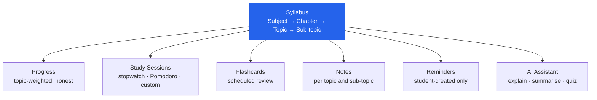
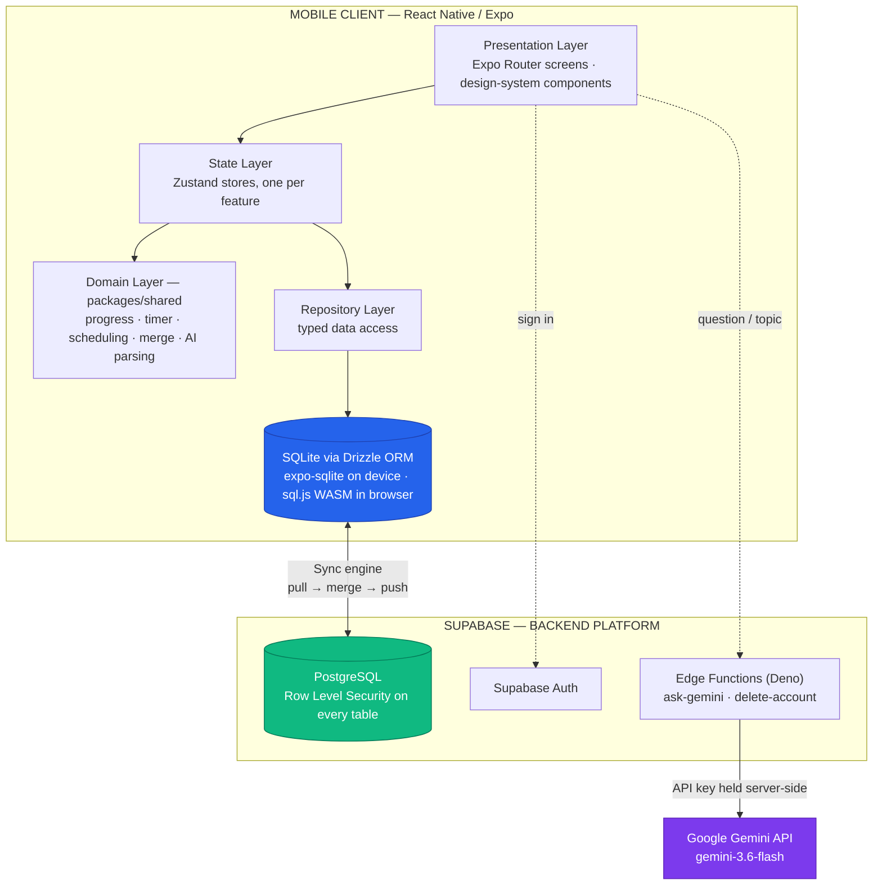
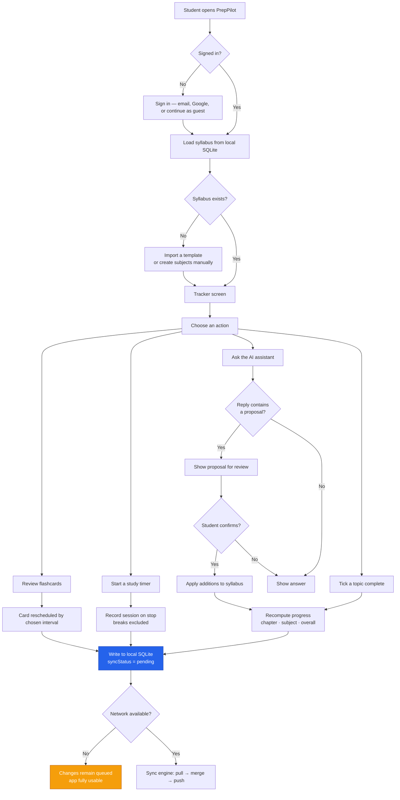
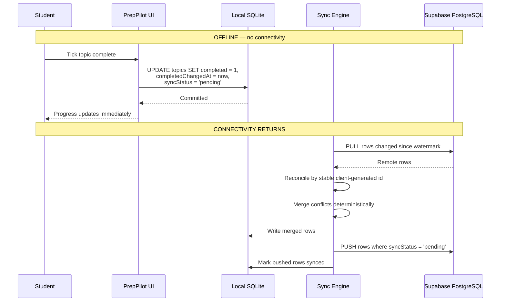
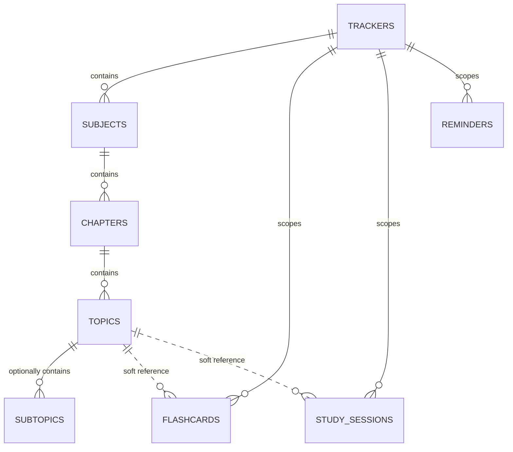
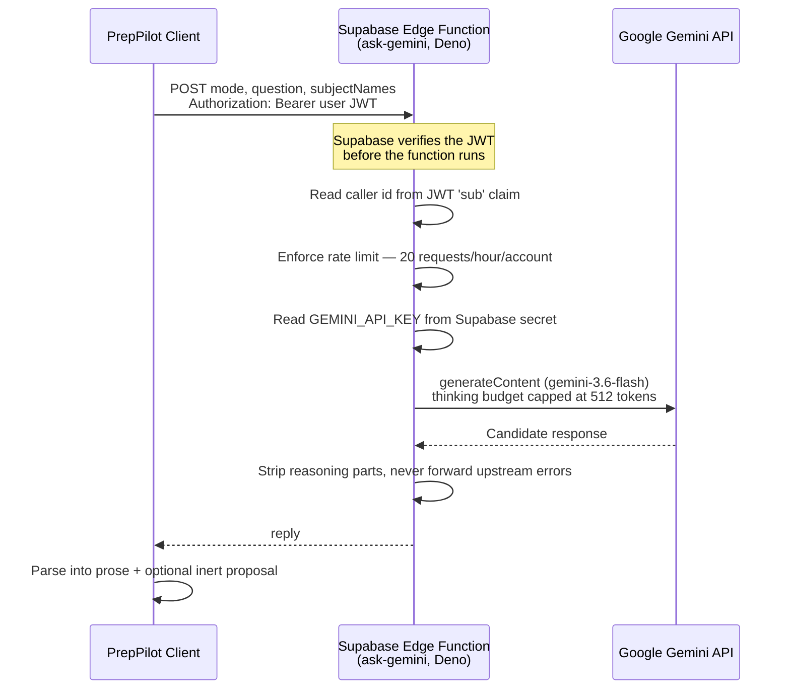
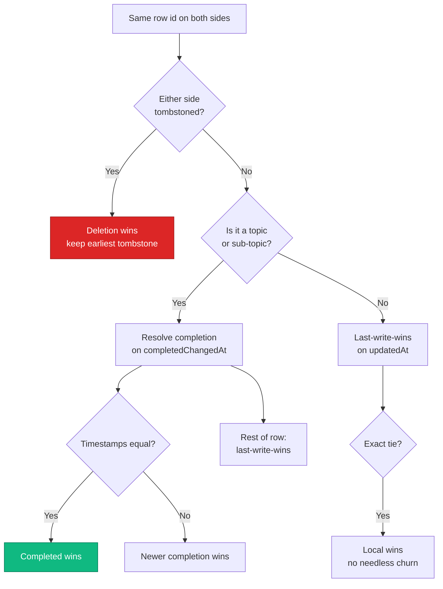

<div align="center">

# VIDYA UNIVERSITY

## Department of Computer Science & Engineering

---

# PROJECT SYNOPSIS

# **PrepPilot**

### An Offline-First, AI-Assisted Study and Examination Preparation Platform

---

**Submitted by**

| Name              | Roll No.                |
| :---------------- | :---------------------- |
| Archit Jain       | _______________________ |
| Vanshika Rajput   | _______________________ |
| Lavi Chaudhary    | _______________________ |
| Jasmine Chaudhary | _______________________ |

**Branch:** Computer Science & Engineering (Artificial Intelligence & Machine Learning)

**Semester:** 3rd Semester

**Project Guide:** Ms. Kareena

**Date of Submission:** 12 September 2026

</div>

---

<div align="center">

### CERTIFICATE

This is to certify that the project work entitled **"PrepPilot — An Offline-First,
AI-Assisted Study and Examination Preparation Platform"** is a bona fide record of
work carried out by the above-named students of the Department of Computer
Science & Engineering, Vidya University, under the guidance of **Ms. Kareena**,
during the 3rd Semester of the academic session.

<br>

|                         |                                         |
| :---------------------- | --------------------------------------: |
| _______________________ |                 _______________________ |
| **Ms. Kareena**         |                  **Head of Department** |
| Project Guide           | Dept. of Computer Science & Engineering |

</div>

---

> **Diagrams.** Every diagram in this synopsis is written as Mermaid source, so
> it renders directly on GitHub and remains editable. Pre-rendered PNG versions
> of the same diagrams — for printing, or for pasting into Word — are available
> in [`assets/diagrams/`](assets/diagrams/).

---

## Table of Contents

1. [Introduction](#1-introduction)
2. [Background and Context](#2-background-and-context)
3. [Problem Statement](#3-problem-statement)
4. [Motivation](#4-motivation)
5. [Objectives](#5-objectives)
6. [Existing Systems and Their Limitations](#6-existing-systems-and-their-limitations)
7. [Proposed System](#7-proposed-system)
8. [Key Features](#8-key-features)
9. [System Architecture](#9-system-architecture)
10. [Methodology and Working Flow](#10-methodology-and-working-flow)
11. [Offline-First Architecture](#11-offline-first-architecture)
12. [Database and Data Model](#12-database-and-data-model)
13. [Progress Tracking and Calculation](#13-progress-tracking-and-calculation)
14. [Study Timers and Sessions](#14-study-timers-and-sessions)
15. [Flashcards and Review Scheduling](#15-flashcards-and-review-scheduling)
16. [Notes, Reminders and Focus Mode](#16-notes-reminders-and-focus-mode)
17. [Syllabus Templates and Multi-Course Support](#17-syllabus-templates-and-multi-course-support)
18. [Authentication](#18-authentication)
19. [AI Integration](#19-ai-integration)
20. [Synchronisation and Conflict Resolution](#20-synchronisation-and-conflict-resolution)
21. [Security](#21-security)
22. [Technology Stack](#22-technology-stack)
23. [Testing and Validation](#23-testing-and-validation)
24. [Results and Current Outcome](#24-results-and-current-outcome)
25. [Limitations](#25-limitations)
26. [Future Scope](#26-future-scope)
27. [Conclusion](#27-conclusion)
28. [References](#28-references)

---

## 1. Introduction

**PrepPilot** is a mobile application that helps a student organise a syllabus,
record what they have genuinely completed, time their study, and revise — whether
or not they have an internet connection at that moment.

The application is built around a single organising idea: **a student's syllabus
is a structure, and progress is a measurement over that structure.** A syllabus is
represented as a four-level hierarchy — _Subject → Chapter → Topic → optional
Sub-topic_ — and every feature in the product hangs off it. Timers record time
against a topic. Flashcards are written for a topic. Notes are attached to a
topic. Reminders can point at one. The AI assistant answers questions about one.

PrepPilot is deliberately **tracker-first and AI-second**. The artificial
intelligence assists the workflow; it never drives it, and — as a matter of
enforced program structure rather than policy — it cannot alter a student's
syllabus without explicit confirmation.

The application is **offline-first** in a strict technical sense: the on-device
SQLite database is the source of truth for every read and write. The cloud is a
synchronisation target, not a dependency. Closing the network connection does not
degrade the tracker; it simply means changes queue until a connection returns.

---

## 2. Background and Context

Students preparing for board examinations, competitive entrance examinations and
professional qualifications share a common problem that is organisational rather
than academic: **syllabi are large, and progress through them is difficult to
see.**

A CBSE Class 12 science syllabus, a JEE Main syllabus or a UPSC Civil Services
syllabus each contains hundreds of individually learnable topics distributed
across subjects and chapters. Students typically track them using paper
checklists, spreadsheets, or memory. Each fails differently. Paper cannot compute
a percentage. Spreadsheets are laborious to maintain on a phone. Memory is
unreliable precisely where reliability matters most — in the final weeks before an
examination.

Simultaneously, a practical constraint shapes the design: **study frequently
happens where connectivity does not.** Libraries, hostels, trains, and rural areas
all impose intermittent connectivity. An application that requires a network
round-trip to tick a checkbox is unusable in exactly the circumstances where
students most need it.

---

## 3. Problem Statement

Students preparing for examinations lack a single, reliable, offline-capable tool
that answers the question _"how much of my syllabus have I actually finished?"_
honestly, and that supports the study workflow — timing, revision, note-taking —
against that same structure.

The specific deficiencies in current practice are:

1. **No accurate progress measurement.** Existing methods cannot compute
   meaningful completion across a hierarchical syllabus of unequal parts.
2. **Connectivity dependence.** Most study applications require an active
   internet connection for basic operation.
3. **Fragmentation.** Syllabus tracking, timers, flashcards and notes typically
   live in three or four unconnected applications, so none of them shares
   context with the others.
4. **Misleading metrics.** Naive progress calculations — most commonly averaging
   chapter percentages — systematically misrepresent how much work remains.
5. **Unsafe automation.** Applications that let an AI modify a student's study
   plan without review risk destroying deliberate work.

---

## 4. Motivation

The motivating insight is that **an incorrect progress figure is worse than no
progress figure at all.** A student who believes they are 50% through a subject
when they are in fact 1% through it will allocate their remaining weeks wrongly.

Consider a subject containing two chapters: one with a single topic that is
complete, and one with ninety-nine topics of which none is complete. Averaging the
two chapter percentages gives **(100% + 0%) / 2 = 50%**. The truthful answer —
completed topics divided by total topics — is **1 / 100 = 1%**.

This is not a hypothetical concern. It is the obvious implementation, and it is
wrong. PrepPilot treats getting this right as the product's core promise, and the
progress engine is guarded by an explicit regression test against precisely this
mistake.

A second motivation concerns **honesty in reporting capability**. Where a platform
restriction prevents a feature from working as a student might expect, PrepPilot
states this in the interface rather than allowing a false impression to form. The
Focus Mode screen, for example, lists what it cannot do alongside what it can.

---

## 5. Objectives

| #   | Objective                                                                 | Status                  |
| :-- | :------------------------------------------------------------------------ | :---------------------- |
| 1   | Represent a syllabus as a four-level hierarchy with per-item completion   | Achieved                |
| 2   | Compute topic-weighted progress that never misrepresents completion       | Achieved                |
| 3   | Function fully offline, with the local database as the source of truth    | Achieved                |
| 4   | Synchronise across devices with deterministic conflict resolution         | Achieved                |
| 5   | Record study time accurately across app backgrounding and process death   | Achieved                |
| 6   | Provide revision tooling — flashcards, notes — bound to the syllabus      | Achieved                |
| 7   | Integrate AI assistance without exposing API credentials on the client    | Achieved                |
| 8   | Prevent AI from modifying the syllabus without explicit user confirmation | Achieved                |
| 9   | Ship ready-made syllabi for common Indian examinations                    | Achieved — 22 templates |
| 10  | Isolate every user's data at the database level                           | Achieved — RLS enforced |
| 11  | Support multiple concurrent courses per student                           | Achieved                |
| 12  | Validate the system through automated testing                             | Achieved — 1,799 tests  |

---

## 6. Existing Systems and Their Limitations

| Approach                                               | Limitation                                                                               |
| :----------------------------------------------------- | :--------------------------------------------------------------------------------------- |
| **Paper checklists**                                   | Cannot compute progress; no backup; lost if misplaced; no time tracking                  |
| **Spreadsheets**                                       | Laborious on a phone; manual formulas; no revision tooling; no reminders                 |
| **Generic to-do applications** (Todoist, Google Tasks) | Flat or two-level lists; no concept of a syllabus; no weighted progress                  |
| **Flashcard applications** (Anki, Quizlet)             | Excellent at revision, but hold no syllabus structure and no progress model              |
| **Pomodoro timers** (Forest, Focus To-Do)              | Time only; no connection to what was studied                                             |
| **Online coaching portals**                            | Require constant connectivity; content-locked; track _their_ syllabus, not the student's |

### The gap

No existing tool combines a **structured syllabus model**, an **honest
progress calculation**, **offline-first operation**, and **integrated study
tooling** in one application. Students consequently operate three or four
applications that share no context, and the syllabus — the thing everything
should hang off — exists in none of them.

---

## 7. Proposed System

PrepPilot proposes a single application in which the syllabus is the central data
structure and every other feature references it.



Design commitments, each of which is implemented:

1. **The local database is the source of truth.** Every read and write goes to
   on-device SQLite. The cloud synchronises; it is never in the critical path.
2. **Progress is computed in exactly one place.** A single pure module computes
   chapter, subject and overall progress in one traversal, so the figures on
   screen cannot disagree with each other.
3. **The AI may propose, never apply.** Enforced by the program's structure.
4. **Secrets never reach the device.** The Gemini key lives only in a
   server-side Edge Function.
5. **Deletion is by tombstone.** Rows are never hard-deleted, so a deletion made
   offline is not resurrected by the next synchronisation.

---

## 8. Key Features

| Feature                   | Description                                                                     | Status                                |
| :------------------------ | :------------------------------------------------------------------------------ | :------------------------------------ |
| **Syllabus tracker**      | Four-level hierarchy with per-item completion, reordering and inline editing    | Implemented                           |
| **Honest progress**       | Topic-weighted; empty chapters report "—", never 0%                             | Implemented                           |
| **Study timers**          | Stopwatch, Pomodoro and custom countdown, recorded against a topic              | Implemented                           |
| **Session history**       | Every session recorded, with the syllabus names snapshotted                     | Implemented                           |
| **Dashboard**             | Completion, time today, total time, study streak, per-subject bars, 7-day chart | Implemented                           |
| **Flashcards**            | Cards per topic, with four fixed review intervals                               | Implemented                           |
| **Notes**                 | Free-text notes per topic and sub-topic, managed in one screen                  | Implemented                           |
| **Reminders**             | Student-created, with none/daily/weekdays/weekly repeat                         | Implemented (platform-limited on web) |
| **Focus Mode**            | Distraction-free screen, keeps the display awake, counts departures             | Implemented (cannot block other apps) |
| **AI assistant**          | Ask, summarise a topic, generate a 3-question quiz                              | Implemented                           |
| **Syllabus templates**    | 22 bundled syllabi, importable offline                                          | Implemented                           |
| **Multi-course tracking** | Independent trackers, e.g. GATE and UPSC in parallel                            | Implemented                           |
| **Cloud sync**            | Eight tables, deterministic conflict resolution                                 | Implemented                           |
| **Authentication**        | Email/password, Google OAuth, guest mode                                        | Implemented                           |
| **Phone OTP**             | Complete, behind a feature flag                                                 | Configuration-gated                   |

---

## 9. System Architecture

PrepPilot is a **layered client application with a managed cloud backend**. There
is no custom application server — Node.js is used as the development toolchain
only.



### Layer responsibilities

| Layer                          | Responsibility                                                                                                              |
| :----------------------------- | :-------------------------------------------------------------------------------------------------------------------------- |
| **Presentation**               | Screens and reusable components; holds no business logic                                                                    |
| **State**                      | Per-feature Zustand stores; orchestrates actions and holds UI state                                                         |
| **Domain** (`packages/shared`) | Pure, framework-agnostic logic — no React Native imports, so it runs identically in the app, the browser and the test suite |
| **Repository**                 | Typed data access over Drizzle; the only layer that issues queries                                                          |
| **Local database**             | SQLite; the source of truth                                                                                                 |
| **Cloud**                      | Supabase — Auth, PostgreSQL with RLS, and two Deno Edge Functions                                                           |

The domain layer being framework-agnostic is a deliberate structural choice: the
mobile app and the browser build compute progress with the _same_ code, so the two
can never disagree about a percentage.

---

## 10. Methodology and Working Flow

### Development methodology

The project follows an **incremental, decision-logged methodology**. Each
significant architectural choice is recorded in `DECISIONS.md` with its reasoning
and its alternatives, so a later reader can see not only what was built but why.
Continuous integration gates every change.

### Typical working flow



The critical property visible here: **the local write completes regardless of
network state.** Synchronisation is a separate, later concern.

---

## 11. Offline-First Architecture

"Offline-first" is used precisely. It does not mean _"caches data for offline
viewing"_; it means **the local database is authoritative and the network is
optional**.



### The three properties that make it work

**1. Client-generated identifiers.** Every row's primary key is a **UUIDv7
generated on the device**. A record created with no network has its final
identifier immediately. Without this, the same record created offline would arrive
at the server as a _duplicate_ rather than as a _conflict_.

**2. Tombstones rather than hard deletes.** A deleted row is marked with
`deletedAt` and retained. If rows were removed outright, a row deleted offline
would be re-inserted by the next pull — the pull cannot distinguish _"deleted
here"_ from _"not yet seen"_.

**3. A server-side watermark.** The next pull resumes from the newest `updated_at`
the **server** reported, not from the device clock. A device whose clock runs fast
would otherwise bookmark a future instant and silently skip every row written in
between.

---

## 12. Database and Data Model

### Local schema — nine tables

| Table            | Purpose                                   |     Synchronised      |
| :--------------- | :---------------------------------------- | :-------------------: |
| `trackers`       | One exam or course being prepared for     |          Yes          |
| `subjects`       | Top level of the syllabus                 |          Yes          |
| `chapters`       | Second level                              |          Yes          |
| `topics`         | Third level — the primary completion unit |          Yes          |
| `subtopics`      | Optional fourth level                     |          Yes          |
| `flashcards`     | Revision cards, with scheduling state     |          Yes          |
| `study_sessions` | Recorded periods of study                 |          Yes          |
| `reminders`      | Student-created reminders                 |          Yes          |
| `preferences`    | Key/value settings, e.g. theme            | **No — device-local** |

### Conventions applied to every synchronised table

| Convention                                 | Reason                                                                 |
| :----------------------------------------- | :--------------------------------------------------------------------- |
| `id` — client-generated UUIDv7             | An offline-created row has its final identity at once                  |
| `userId` denormalised onto every row       | One predicate scopes a query; RLS policies mirror it exactly           |
| Timestamps as epoch milliseconds (INTEGER) | SQLite has no date type; text would make ordering formatting-dependent |
| `deletedAt` tombstone                      | Deletions survive synchronisation                                      |
| `syncStatus` — `pending` \| `synced`       | Tracks what the server has not yet seen                                |
| `completedChangedAt` on topics/sub-topics  | Lets completion resolve independently of a rename                      |

### Hierarchy



### Soft references — a deliberate design decision

`study_sessions` and `flashcards` deliberately carry **no foreign key** to
subjects, chapters or topics. They keep the identifiers as plain references
alongside a **snapshot of the names**.

The reason: deleting a subject must not shrink _"total time studied using
PrepPilot"_. The student really did spend that time. Equally, deleting a topic
must not silently destroy the flashcards written for it or the review history
behind them. The name snapshot keeps history readable after the syllabus is
renamed or reorganised.

### Cloud schema

Four PostgreSQL migrations mirror the local schema, each table carrying Row Level
Security. Every synchronised table references `auth.users(id) ON DELETE CASCADE`,
so deleting an account removes everything the student owned by cascade.

---

## 13. Progress Tracking and Calculation

Progress is the product's core promise, so it is computed in one pure module and
tested exhaustively.

### Rule 1 — Progress is topic-weighted, not an average of percentages

Subject progress is _all completed units under the subject ÷ all units under the
subject_. It is explicitly **not** the mean of chapter percentages.

> A subject with a 1-of-1 chapter and a 0-of-99 chapter is **1% complete**, not
> 50%. The averaging implementation — obvious, and wrong — is guarded by an
> explicit regression test.

### Rule 2 — Nothing to measure is not zero

A chapter with no topics reports `percent: null`, **not** `0`, and renders as an
em dash (—). A chapter that has not been filled in yet is _unmeasured_, not
_unstarted_, and showing 0% would misrepresent it.

### Rule 3 — Sub-topics become the counted unit

Where a topic has sub-topics, those sub-topics are counted instead of the topic
itself. A topic broken into four parts therefore weighs four times one that is
not — because it genuinely is four times the work.

### Rule 4 — Rounding is honest

9,999 of 10,000 topics displays as **99%**, never a falsely triumphant 100%.

### Single-traversal computation

Ticking one topic must update the topic, its chapter, its subject, the overall
figure and the dashboard _together_. All five are derived from **one traversal**,
which keeps them mutually consistent by construction and keeps the cost linear in
the number of topics.

---

## 14. Study Timers and Sessions

Three modes are supported: **stopwatch**, **Pomodoro**, and **custom countdown**.

### Elapsed time is derived, never accumulated

Elapsed time is computed from **timestamps** (`now − startedAt + banked`), never
by a ticking counter that increments each second.

The reason is a real failure mode: Android suspends background processes. A
ticking counter stops when the process is suspended and would quietly
under-report a session the moment a student locked their screen. Deriving from a
start timestamp survives backgrounding and process death without requiring a
foreground service.

Sessions interrupted by the application being killed are recorded with status
`abandoned`, retaining whatever the last heartbeat recorded — so a crash costs at
most one heartbeat interval rather than the entire sitting.

### Pomodoro breaks are excluded from study time

Break phases are **not** counted as study time. Counting them would inflate the
"total time studied" figure and render it meaningless. The Pomodoro configuration
is adjustable within bounds — work 5–120 min, short break 1–60 min, long break
5–120 min, 2–8 cycles before a long break — defaulting to the standard
25/5/15/4 with manual phase advance.

---

## 15. Flashcards and Review Scheduling

Flashcards are written against a topic, so a student revises what they are
actually tracking.

### What is implemented — stated precisely

The review screen presents **four fixed intervals: 5 minutes, 1 day, 2 days and
4 days.** The student chooses one after seeing the answer, and the card returns
after that interval.

The reasoning is recorded in the source: a fully adaptive schedule changes its
button labels on every review, so a student cannot learn what "1 day" will do —
on a mature card it is not a day. Fixed intervals say exactly what they do, which
makes the choice a judgement about the card rather than a guess about the
algorithm.

> **An accurate description.** PrepPilot implements **fixed-interval spaced
> repetition**. A complete **SM-2** implementation (the algorithm behind Anki and
> SuperMemo) exists in the shared package and is exhaustively tested, and the
> SM-2 bookkeeping — ease factor, repetitions, lapses — is maintained underneath
> every review, so the history needed to switch to adaptive scheduling is being
> kept. **But the review screen does not currently call it.** It would be
> inaccurate to describe the shipping application as using SM-2 scheduling.

Cards reference their topic **softly** — no foreign key, and the topic name is
snapshotted — so deleting a topic destroys neither the cards written for it nor
their review history.

---

## 16. Notes, Reminders and Focus Mode

### Notes

Free-text notes attach to a topic or a sub-topic, and are managed from a single
dedicated screen. Notes live where a student looks for them: having to locate the
right topic in a collapsed syllabus in order to fix a typo is how notes stop being
worth writing.

### Reminders

Reminders are **only ever created by the student** — PrepPilot never invents
schedules of its own. Repeat rules are `none`, `daily`, `weekdays` and `weekly`.
Recurrence advances day by day rather than by adding a fixed span, so wall-clock
time survives month ends and daylight-saving shifts.

**Platform behaviour differs, and is stated in the interface:**

| Platform    | Behaviour                                                                                                                                                        |
| :---------- | :--------------------------------------------------------------------------------------------------------------------------------------------------------------- |
| **Android** | `expo-notifications`; the operating system holds the schedule                                                                                                    |
| **Web**     | A timer held in the browser tab. **Reminders stop when the tab is closed** — the screen says so rather than letting a student trust an alarm that will not sound |

**Weekday reminders are re-armed by the application**, because neither platform
offers a weekday-only trigger. If the application is never opened, they stop
firing.

### Focus Mode

Focus Mode provides a single distraction-free screen, keeps the display awake for
the duration of a session, suppresses PrepPilot's own reminders, and **counts the
number of times the student leaves the application**.

> **What it deliberately does not do.** Focus Mode **cannot block other
> applications**, and **does not toggle Do Not Disturb**. Android does not permit
> app-blocking without an AccessibilityService or device-administrator
> privileges, both restricted by Play Store policy; Do Not Disturb requires a
> system permission no Expo module exposes. Rather than implying otherwise, the
> screen displays a capability list stating plainly what is and is not possible.

---

## 17. Syllabus Templates and Multi-Course Support

### The template library — 22 bundled syllabi

| Group                         | Count | Entries                                                                                        |
| :---------------------------- | :---: | :--------------------------------------------------------------------------------------------- |
| Generated from source syllabi |   3   | JEE Main 2026, JEE Advanced 2026, NEET UG 2026                                                 |
| CBSE, hand-written            |  10   | Classes 9 and 10; Classes 11 and 12 in PCM, PCMB, Commerce and Humanities                      |
| Competitive and professional  |   9   | UPSC CSE, SSC CGL, GATE CS/IT, NEET PG, CA Foundation, CA Intermediate, CA Final, MBBS, DevOps |

Two additional entries are included and clearly labelled as **examples**.

Templates are **bundled with the application, not fetched**, so importing one
works with no connectivity. Each carries a `source` string and a `verified` flag,
both displayed in the library, so an unchecked template cannot appear official to
a student planning months of study around it.

**Importing copies the syllabus.** The `templateId` is a label, not a live link —
the student's copy is theirs from that moment and free to diverge.

### Multi-course support

A **tracker** represents one examination or course. Everything a student does
belongs to exactly one tracker — the syllabus, the notes, the cards, the sessions.
A student sitting both GATE and UPSC keeps two, and switching between them
switches all of it, because an hour of GATE revision is not progress towards UPSC
and displaying it as such would be untrue.

---

## 18. Authentication

Authentication is provided by Supabase Auth.

| Method               | Status                  | Notes                                                                   |
| :------------------- | :---------------------- | :---------------------------------------------------------------------- |
| **Email + password** | Implemented             | Validation shared between client and tests                              |
| **Google OAuth**     | Implemented             | PKCE through the system browser; appears once a client id is configured |
| **Phone OTP**        | Implemented, flag-gated | Requires an SMS provider; never tested against real delivery            |
| **Guest mode**       | Implemented             | Local-only; the tracker works, the AI assistant does not                |

Google sign-in uses the **system browser rather than an embedded WebView** —
Google refuses to authenticate in a WebView, and the system browser is also the
only surface that can reuse an existing Google session, so most students never
type a password. The PKCE code verifier never leaves the device, so an intercepted
redirect grants nothing on its own.

Sessions are held in `expo-secure-store`, backed by the Android Keystore.

> **A recorded design compromise:** sign-in is required before first use, so
> "offline-first" means _offline-first after the first sign-in_. This is logged
> as decision D1.

---

## 19. AI Integration

### The request path

The client **never contacts Gemini directly**, and the Gemini API key **never
reaches a device**.



The caller's identity is read from the **JWT `sub` claim**, not from a header — a
header is whatever the caller types, so a limit keyed on one is bypassed by
changing it.

### The three modes

| Mode        | What it does                                                                        |
| :---------- | :---------------------------------------------------------------------------------- |
| `ask`       | Answers a free-text question, given the names of the student's subjects for context |
| `summarize` | Summarises one topic in at most six sentences                                       |
| `quiz`      | Generates exactly three multiple-choice questions with four options each            |

### AI safety — a structural guarantee, not a prompt instruction

**The AI cannot modify a student's syllabus.** This is enforced by the shape of
the program, not by asking the model politely.

A model reply is parsed into an **inert proposal object**. The proposal grammar
admits exactly two verbs:

- `addChapters`
- `addTopics`

**There is no verb for deleting, completing, renaming or reordering anything.** A
reply requesting such an operation cannot be represented, so it cannot be applied.

The flow is:

```
AI Proposal  →  User Review  →  Explicit Confirmation  →  Apply
```

Nothing in the parsing layer touches storage. Applying is a separate, explicitly
confirmed step. Names returned by the model are validated exactly as typed user
input is — a name from a model is untrusted input like any other. A proposal
larger than 200 topics is flagged as too large to review meaningfully.

### Constraints, stated accurately

- **The AI requires connectivity.** It is the one part of PrepPilot that cannot
  work offline, and the interface says so.
- **The rate limit is per-instance**, held in memory. It bounds runaway use; it
  is not a durable quota.
- **Summaries and quizzes work from the topic's name and its position in the
  syllabus**, because a template stores names and nothing else. The model is
  instructed to say when a name is too vague rather than invent content for it.

---

## 20. Synchronisation and Conflict Resolution

### Pull, merge, then push

Synchronisation runs **pull → merge → push**, one table at a time, parents before
children — a chapter arriving before its subject would violate a foreign key on
the server.

The ordering matters. Pushing first appears natural — send my work, then collect
theirs — but it overwrites the server with a local row that has not yet been
reconciled, destroying any change made elsewhere since the last synchronisation.
Merging first means what is pushed is already the agreed version.

### The conflict resolution rules



| #   | Rule                                                                           | Reason                                                                         |
| :-- | :----------------------------------------------------------------------------- | :----------------------------------------------------------------------------- |
| 1   | **A tombstone wins.** Deletion is sticky                                       | Resurrecting something a student deleted is worse than losing an edit to it    |
| 2   | **Completion resolves on its own timestamp**                                   | Renaming a topic on one device must not revert a tick made on another          |
| 3   | **A tie on completion resolves to _completed_**                                | Silently un-ticking finished work is the failure a student would never forgive |
| 4   | **Everything else is last-write-wins** on `updatedAt`; local wins an exact tie | Deterministic, and a device never churns rows it already agrees with           |

Rule 2 is why `topics` and `subtopics` carry a separate `completedChangedAt`
column. Without a per-field timestamp, a rename and a tick made on two different
devices are indistinguishable, and one silently overwrites the other.

Eight tables synchronise. `preferences` deliberately does not — a theme choice is
a property of a device, not of an account.

---

## 21. Security

### Credential handling

| Secret                        | Where it lives                                                                                                               |
| :---------------------------- | :--------------------------------------------------------------------------------------------------------------------------- |
| Supabase **anon key**         | In the client bundle — this is correct; it is a publishable identifier whose power is bounded entirely by Row Level Security |
| Supabase **service-role key** | Server-side only, inside the `delete-account` Edge Function                                                                  |
| **Gemini API key**            | Server-side only, inside the `ask-gemini` Edge Function, read from a Supabase secret                                         |

Only `EXPO_PUBLIC_*` values are compiled into the application bundle, and the
configuration module documents that everything in it is readable by anyone who
downloads the app.

### Row Level Security

RLS is both **enabled and forced** on every table. Forcing matters: without it,
policies do not apply to the table owner.

Policies exist for **select, insert and update**, each scoped to `auth.uid()`.

> **There is deliberately no delete policy anywhere.** Deletion happens by
> tombstone, and the _absence_ of the policy is what enforces that at the database
> rather than merely by convention in client code.

### Account deletion

The `delete-account` Edge Function verifies the bearer token **against Supabase**
rather than merely decoding it, and reads **no identifier from the request body**.
The account deleted is therefore always the caller's own and can never be another.
Everything the student owned is removed by the `ON DELETE CASCADE` chain.

### Known security limitations

- **The local SQLite database is not encrypted.**
- **The AI rate limit is in-memory per instance**, so it is not a durable quota.
- **Demo mode bypasses authentication entirely** — gated behind an explicit
  flag, labelled on every screen, and never on by default.

---

## 22. Technology Stack

| Category                 | Technology                                                          |
| :----------------------- | :------------------------------------------------------------------ |
| **Language**             | TypeScript (strict), SQL                                            |
| **Mobile framework**     | React Native 0.86, Expo SDK 57                                      |
| **UI**                   | React 19, Expo Router, NativeWind, React Native SVG, Reanimated     |
| **State management**     | Zustand 5                                                           |
| **Local database**       | SQLite — `expo-sqlite` on device, `sql.js` (WebAssembly) in browser |
| **ORM**                  | Drizzle ORM 0.45 with Drizzle Kit                                   |
| **Backend platform**     | **Supabase**                                                        |
| **Cloud database**       | PostgreSQL with Row Level Security                                  |
| **Authentication**       | Supabase Auth                                                       |
| **Serverless functions** | Supabase Edge Functions (Deno)                                      |
| **AI**                   | Google Gemini — `gemini-3.6-flash`                                  |
| **Web rendering**        | React Native Web                                                    |
| **Build / deployment**   | EAS Build (Android APK), Metro bundler                              |
| **CI**                   | GitHub Actions                                                      |
| **Testing**              | Jest + jest-expo, Vitest, Testing Library, Deno test                |
| **Tooling**              | Node.js 22, pnpm 11, Prettier                                       |

> **Terminology note.** **Node.js is the development toolchain**, running the
> bundler, test runners and formatter. It is **not** this project's backend — no
> Node server exists in the repository. **Supabase is the backend.**

---

## 23. Testing and Validation

### Automated test suite

| Package           | Suites |   Tests   | Result          |
| :---------------- | :----: | :-------: | :-------------- |
| `packages/shared` |   15   |    512    | All passing     |
| `apps/mobile`     |   65   |   1,287   | All passing     |
| **Total**         | **80** | **1,799** | **All passing** |

Measured by running the suite from a clean install. Coverage thresholds are
enforced in continuous integration.

### Continuous integration

On every push to `main` and every pull request, GitHub Actions runs:

1. Formatting check (Prettier)
2. Type-checking across every package
3. Full test suite with coverage thresholds enforced
4. **Deno tests for the Edge Functions** — they run on Deno, so the Node suite
   cannot see them, and they are the only code that ever holds the Gemini key
5. **An Android bundle build** — a green test suite does not prove the app still
   bundles through a pnpm workspace
6. **A web bundle build** — the browser database driver is excluded from unit
   coverage because it needs WebAssembly and a DOM, so building it here is what
   keeps that path from rotting unnoticed

### Manual and device validation

The Android APK has been built via EAS and tested on a physical Android device.
The Supabase project, the deployed `ask-gemini` Edge Function and the Gemini key
are live and functioning.

---

## 24. Results and Current Outcome

PrepPilot is a working application, not a prototype. The following are
implemented, tested and verified:

- A **four-level syllabus tracker** with per-item completion, reordering and
  inline editing
- A **progress engine** that is topic-weighted, treats empty as unmeasured, and
  rounds honestly
- **Three timer modes** recording sessions that survive backgrounding and process
  death, excluding Pomodoro breaks
- A **dashboard** showing completion, time today, cumulative time, study streak,
  per-subject progress and a seven-day chart
- **Flashcards, notes and reminders**, each bound to the syllabus
- **Focus Mode**, with an in-app statement of its own limitations
- An **AI assistant** with three modes, reached through a server-side proxy, and
  structurally incapable of modifying the syllabus without confirmation
- **22 bundled syllabus templates** importable offline
- **Multi-course tracking** through independent trackers
- **Cross-device synchronisation** with deterministic conflict resolution
- **Row Level Security** isolating every student's data at the database
- A **browser build** of the same application, running SQLite via WebAssembly
- **1,799 automated tests**, all passing, gated by continuous integration

---

## 25. Limitations

Stated plainly, because a limitation known and documented is a smaller problem
than one discovered by a user.

| Limitation                                          | Detail                                                                             |
| :-------------------------------------------------- | :--------------------------------------------------------------------------------- |
| **Focus Mode cannot block other applications**      | Android forbids it without restricted privileges                                   |
| **Do Not Disturb is not toggled**                   | Requires a system permission no Expo module exposes                                |
| **Web reminders stop when the tab closes**          | A browser tab has no OS-level scheduler                                            |
| **Weekday reminders need the app opened to re-arm** | Neither platform offers a weekday-only trigger                                     |
| **The local database is not encrypted**             | SQLite is stored in plaintext on the device                                        |
| **The AI requires connectivity**                    | The one feature that cannot work offline                                           |
| **The AI rate limit is not durable**                | In-memory and per-instance                                                         |
| **Flashcards do not use adaptive scheduling**       | Four fixed intervals; SM-2 exists but is not wired to the UI                       |
| **Sign-in is required before first use**            | "Offline-first" means offline-first _after_ first sign-in                          |
| **Reordering is menu-based**                        | Up/down from a menu, not drag-and-drop                                             |
| **Device testing is not systematic**                | Verified on a device, not measured across Android versions or OEM battery policies |
| **iOS is untested**                                 | The codebase targets Android; nothing prevents iOS, but nothing verifies it        |

---

## 26. Future Scope

| Enhancement                          | Description                                                                                                        |
| :----------------------------------- | :----------------------------------------------------------------------------------------------------------------- |
| **Adaptive review scheduling**       | Wire the existing, tested SM-2 implementation to the review screen; the required history is already being recorded |
| **Drag-and-drop reordering**         | The repositories already support arbitrary reordering                                                              |
| **Local database encryption**        | SQLCipher or an equivalent, for data at rest                                                                       |
| **Durable AI rate limiting**         | Move the limit into PostgreSQL so it survives instance recycling                                                   |
| **Systematic device matrix testing** | Particularly notification delivery under OEM battery optimisation                                                  |
| **iOS release**                      | The codebase is cross-platform; verification is the missing work                                                   |
| **Expanded template library**        | More state boards and professional qualifications                                                                  |
| **Collaborative study groups**       | Shared syllabi and comparative progress                                                                            |
| **Richer analytics**                 | Time-of-day productivity patterns, subject-level pace projections                                                  |
| **Widget and quick actions**         | Start a timer or tick a topic from the home screen                                                                 |
| **Verified template provenance**     | A review process establishing the `verified` flag against awarding-body sources                                    |

---

## 27. Conclusion

PrepPilot demonstrates that a student-facing application can be **both technically
rigorous and honest about its own limits**.

The technical contribution is threefold. First, a **genuinely offline-first
architecture** in which the local database is authoritative — made workable by
client-generated identifiers, tombstone deletion and a server-side watermark, each
of which addresses a specific failure mode that a naive implementation would hit.
Second, a **progress model that refuses to flatter the user**: topic-weighted
rather than averaged, unmeasured rather than zero, and rounded honestly. Third, an
**AI integration whose safety is structural** — the proposal grammar has no verb
for destruction, so unsafe operations are not merely discouraged, they are
inexpressible.

Equally deliberate is what PrepPilot declines to claim. Focus Mode does not
pretend to block applications it cannot block. Web reminders say they will stop
when the tab closes. The flashcard scheduler is described as what it is. This
posture is not modesty for its own sake; a student planning months of preparation
around a tool needs that tool to be accurate about itself.

The result is an application of **1,799 passing tests** across a monorepo of
roughly 55,000 lines, running on Android and in the browser from one codebase,
with a syllabus library covering the examinations Indian students most commonly
sit — and a documented account of everything it does not yet do.

---

## 28. References

1. **React Native** — <https://reactnative.dev/>
2. **Expo Documentation** — <https://docs.expo.dev/>
3. **Supabase Documentation** — <https://supabase.com/docs>
4. **Supabase Row Level Security** — <https://supabase.com/docs/guides/database/postgres/row-level-security>
5. **Drizzle ORM** — <https://orm.drizzle.team/>
6. **SQLite** — <https://www.sqlite.org/docs.html>
7. **Google Gemini API** — <https://ai.google.dev/docs>
8. **Zustand** — <https://zustand.docs.pmnd.rs/>
9. **PostgreSQL** — <https://www.postgresql.org/docs/>
10. **Deno Runtime** — <https://docs.deno.com/>
11. Wozniak, P. A. — _Optimization of learning: SuperMemo and the SM-2 algorithm_
12. **RFC 9562** — Universally Unique IDentifiers (UUID), including UUIDv7
13. **CBSE Curriculum** — <https://cbseacademic.nic.in/>
14. **National Testing Agency** (JEE, NEET syllabi) — <https://nta.ac.in/>

### Project documentation

| Document                         | Contents                                                    |
| :------------------------------- | :---------------------------------------------------------- |
| `README.md`                      | Overview and getting started                                |
| `DECISIONS.md`                   | Every architectural decision with its reasoning             |
| `docs/AUDIT.md`                  | Evidence-based audit of implementation versus documentation |
| `docs/TECH_STACK.md`             | The stack as built, with versions                           |
| `docs/developer/LIMITATIONS.md`  | Everything unbuilt, unverified or knowingly compromised     |
| `docs/developer/ARCHITECTURE.md` | Architecture as implemented                                 |
| `docs/developer/SYNC.md`         | Synchronisation engine detail                               |
| `docs/developer/SECURITY.md`     | Security model as implemented                               |

---

<div align="center">

**PrepPilot** · Department of Computer Science & Engineering · Vidya University

_Submitted 12 September 2026_

</div>
